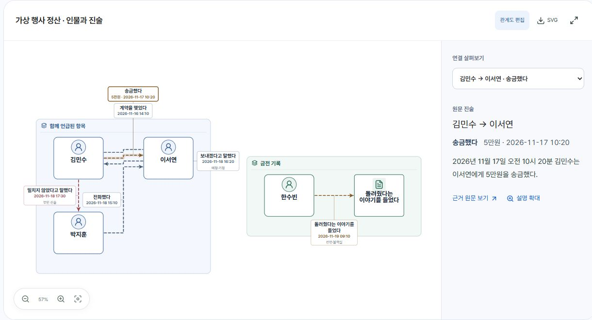
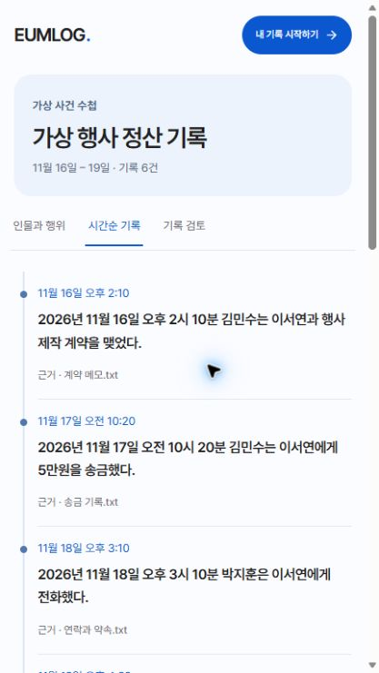
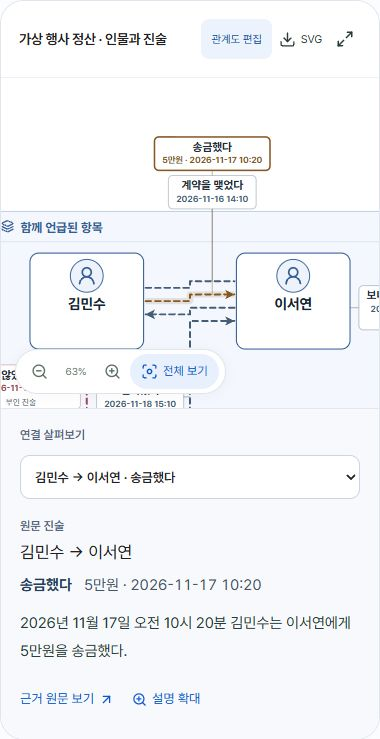
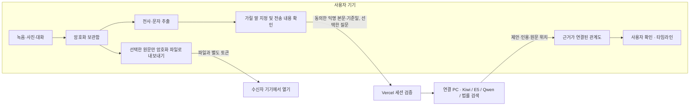

# 이음로그 · EUMLOG

녹음과 메시지에서 **누가 누구에게 무엇을 했다고 말했는지** 찾아, 근거 문장과 시간순 기록을 한 화면에서 확인하는 모바일 웹 앱입니다. 원본은 사용자 기기의 암호화 보관함에 둡니다.

[웹 작업대 시연](https://eumlog-evidence.vercel.app/demo?view=desktop) · [모바일 수첩 시연](https://eumlog-evidence.vercel.app/demo?view=mobile) · [내 보관함 시작하기](https://eumlog-evidence.vercel.app/register) · [설치와 운영](README-LOCAL.md)

## 2분 시연 · 가상 행사 정산 기록

행사를 함께 준비한 네 사람이 계약, 송금, 통화와 반환 여부에 관해 남긴 **가상의 기록 4개**입니다. 시연 페이지는 이 문장들을 실제 분석기로 처리해 저장한 결과를 엽니다. 편집을 연습할 수 있고 새로고침하면 처음 배치로 돌아갑니다. [시연 원문 및 분석 결과](public/demo/scenario.json) · [생성 코드](ai/generate_demo.py) · [개수와 해시](ai/training/demo-run.json)

| 해 볼 일 | 화면에서 확인할 점 |
|---|---|
| **인물과 행위**에서 송금 화살표 선택 | 김민수 → 이서연, 5만 원. 근거 원문을 열어 방향과 금액을 대조합니다. 모바일 수첩은 시간순 기록에서 시작합니다. |
| 이서연의 약속과 김민수의 부인 진술 선택 | 자료를 보내겠다고 한 때와 실제 발송 여부, 밀치지 않았다는 진술과 실제 발생 여부를 구분합니다. |
| 한수빈의 전언 선택 | 돈을 돌려줬다는 이야기를 들었다고 적혀 있습니다. 누가 얼마를 반환받았는지는 원문에 없습니다. |
| **시간순 기록** 선택 | 계약 → 송금 → 전화 → 약속 → 부인 → 전언 순서로 여섯 문장을 확인합니다. |
| **기록 검토**에서 한수빈 선택 | 11월 19일 문장 한 건이 남습니다. 원문을 펼치면 인용이 강조되고, 확인할 정보에 ‘상대방’과 ‘금액’이 표시됩니다. |
| **합성 녹음도 기기에서 읽어보기** 펼치기 | 별도의 한국어 합성 녹음을 직접 재생하고 브라우저에서 전사합니다. 첫 실행에는 공개 모델을 내려받습니다. |

모바일 화면과 시연의 여섯 기록

 

| 일시 · 한국시간 | 원문에 적힌 내용 |
|---|---|
| 2026-11-16 14:10 | 김민수와 이서연이 행사 제작 계약을 맺음 |
| 11-17 10:20 | 김민수가 이서연에게 5만 원 송금 |
| 11-18 15:10 | 박지훈이 이서연에게 전화 |
| 11-18 16:20 | 이서연이 김민수에게 다음 날 자료를 보내겠다고 말함 |
| 11-18 17:30 | 김민수가 박지훈을 밀치지 않았다고 말함 |
| 11-19 09:10 | 한수빈이 이서연의 금전 반환 이야기를 들었다고 말함 |

## 내 자료로 사용하기

1. **Google로 가입하거나 로그인합니다.** 첫 로그인 때 계정을 만들고, 기기 보관함을 열 암호를 별도로 정합니다. 기존 이메일 계정은 현재 비밀번호를 확인한 뒤 Google 계정을 연결할 수 있습니다.
2. 모바일 수첩의 **오늘 일 기록하기** 또는 웹 작업대의 **음성 기록**에서 날짜를 고릅니다. 마이크 권한을 허용해 **직접 녹음**하거나 기존 파일을 고릅니다. 음성 전사와 사진·문서의 문자 추출은 이 기기에서 실행합니다. 이름·날짜·금액은 원본을 보며 바로잡을 수 있습니다.
3. **분석 전, 가릴 정보 확인**에서 실명·학교·주소 등 가릴 말을 추가합니다. 전송될 본문·질문·기준일을 읽고 동의한 뒤 **관계·시점 분석**을 누릅니다. 기기에서 결과와 원문 위치를 맞춰 관계도를 갱신합니다.
4. 화살표를 선택해 원문을 확인하고 **확인·연결**을 누르면 타임라인에 들어갑니다. **법률 근거 찾기**에서 공식 출처와 확인 질문을 보고, **정리·내보내기**에서 확인한 기록을 JSON으로 저장하거나 인쇄합니다.

보관함에서 **시연 자료 불러오기**를 선택하면 같은 합성 사건을 내 기기에 넣어 저장과 편집까지 연습할 수 있습니다. 시연의 시간순 기록은 예시를 위해 미리 연결되어 있습니다.

## 상담·사건 검토에 쓰기

모바일 홈에서는 당일 녹음과 최근 사건을 먼저 봅니다. 웹 작업대에서는 왼쪽 메뉴에서 사건을 열어 관계도·문장 검토·법률 근거·정리 자료를 오갑니다. 작업 화면 전환은 같은 기기의 보관함을 사용합니다. **내 사건** 검색은 저장한 사건 이름, 자료 이름과 원문, 확인한 문장을 기기 안에서 찾습니다.

상담자가 반환 경위를 검토한다면 **기록 검토**에서 한수빈을 고르고 해당 시점의 문장을 엽니다. 파일 이름과 인용 위치를 따라가 이 기록이 전언임을 확인하고, 반환받은 사람·금액처럼 빠진 정보는 다음 상담 질문으로 남깁니다. 원문을 고쳐 이전 인용이 현재 전사와 달라진 경우에는 보존한 이전 버전과 대조합니다. 인용 위치를 확정할 수 없으면 불확실성을 표시합니다. 상담 자료에는 사용자가 확인한 기록을 넣습니다.

기술적으로는 인물 × 시점 × 사건(진술) **3차원 희소 색인**을 사용합니다. 실제 문장에 등장하는 조합만 저장하므로 같은 문장을 여러 인물로 찾을 수 있습니다. ‘시점 미상’은 별도로 조회됩니다. 같은 이름이 다른 인물을 가리킬 수 있어 파일·원문을 함께 확인해야 합니다. [색인 코드](src/domain/services/CaseIndex.ts) · [근거 표시와 필터](src/presentation/components/CaseIndexInspector.tsx)

## 관계도 편집

인물·설명 카드·배경 묶음·행위 화살표를 개별 선택해 이동합니다. 화살표의 라벨·꺾이는 위치와 선 모양을 조절하고 인물에 같은 사건의 사진을 지정할 수 있습니다. 모바일에서 넓게 보려면 전체 화면과 화면 맞춤을 사용하세요. 편집 결과는 텍스트와 경로를 보존한 SVG로 내보낼 수 있습니다. 사진을 넣은 SVG에는 사진도 포함되므로 전달 전에 확인하세요.

**AI 정렬**은 요소 3∼14개의 관계도에서 내장 신경망이 새 좌표를 제안하고, 간격을 보정한 뒤 기본 배치 6개와 비교합니다. 겹침·선 교차·라벨 간격 등 8가지 특징으로 후보를 평가하는 Ridge 랭커도 기기 안에서 실행합니다. 원문 인용과 사용자가 직접 그린 선의 출처 표시는 편집 후에도 유지됩니다.

좌표 신경망은 합성 그래프 480개(노드 4,132개)로 212회 학습했습니다. 별도 그래프 120개(962개 노드)에서 스프링 배치 기준 좌표와의 평균 절대 오차가 초기 0.23027에서 0.02223으로 줄었습니다. 기본 6개 배치에 대한 랭커의 기하 목표 최상위 선택 일치율은 61.67%입니다. 두 측정 모두 사람이 느끼는 가독성은 평가하지 않았습니다. [좌표 학습·평가](ai/training/layout-generator-run.json) · [후보 순위 학습](ai/training/layout-run.json) · [편집 설계](docs/precision-design.md)

## 자료가 이동하는 경로

| 위치 | 담기는 자료와 제어 |
|---|---|
| **기기 보관함** | 원본·전사·실명·관계도·확인 기록은 계정별 IndexedDB에 AES-256-GCM으로 보관합니다. 기기 암호에서 PBKDF2-SHA-256 310,000회로 키를 유도합니다. 같은 브라우저의 탭끼리는 변경 버전을 알리고 기기에서 내용을 다시 읽습니다. |
| **웹·분석 PC** | 검토한 익명 본문과 기준일, 해당하는 경우 익명 질문을 요청 동안 처리합니다. 애플리케이션은 이 경로의 요청 본문과 응답을 저장하지 않습니다. 계정용 가명 식별자·세션·인증 운영 기록, Google·호스팅 서비스의 접속 기록은 별도로 존재할 수 있습니다. 자동 가리기가 문맥상 식별 단서를 놓칠 수 있어 전송 전 직접 확인이 필요합니다. |
| **선택 전달** | 공유할 자료와 동의를 직접 선택하면 원문 텍스트만 담은 암호화 파일과 별도 토큰이 생깁니다. 수신자가 두 가지를 가지고 열면 복호화는 수신자 기기에서 이뤄집니다. 사람의 신원을 확인하는 공유 방식은 아니며 전달 후 열람 횟수·기한 제한과 회수 기능은 없습니다. [수신 화면](https://eumlog-evidence.vercel.app/receive) |
| **백업·이전** | 브라우저 데이터 삭제나 기기 분실에 대비해 암호화 백업과 암호를 따로 보관하세요. 전체 백업 한도는 100MB입니다. 구버전 서버에 보관한 기록은 가져오기와 해시 대조 후, 사용자가 별도 삭제를 승인해야 서버 사본이 삭제됩니다. |

## 실제 학습 데이터와 성능

| 구성 | 실제 작업 | 결과를 읽는 방법 |
|---|---|---|
| 한국어 응답 | Qwen3-1.7B에 합성 400쌍·공식 원문 기반 120쌍·KLUE 관계 120쌍으로 LoRA 학습. 640쌍, 2회 반복, 1,280단계 | 소수 예시로 배율을 비교해 0.15를 사용합니다. 6개 새 질문의 출력에 부정·전언·예정 처리와 오류를 함께 남겼습니다. 한국어 일반 능력이나 법률 판단의 정확도는 측정하지 않았습니다. [실제 답변](ai/training/dialogue-evaluation.json) |
| 사건·관계 유형 | Kiwi로 한국어 형태소와 조사를 나누고 다국어 E5의 문장 표현으로 분류기를 학습 | 사건 6종은 360개 학습·120개 평가에서 70.83%, 관계 7종은 816개 학습·157개 평가에서 88.54%. 관계 분류의 신체 유형 재현율은 50%. 인물 방향과 인용문은 별도로 원문을 대조합니다. [혼동행렬](ai/training/latest-run.json) |
| 한국어 관계 연구 | KLUE RE 12,000개로 E5 LoRA와 30종 분류 헤드를 학습. 중복 문장을 제외한 공식 검증 7,633개 | 정확도 57.15%, Macro F1 0.197. 가장 흔한 유형만 선택해도 약 59.91%여서 실서비스 자동 연결에 채택하지 않았습니다. [평가 결과](ai/training/korean-pairs-run.json) |
| 법률 근거 검색 | 국가법령정보센터 법령 11종·판례 7건을 조문·원문 구간 2,603개로 색인. E5 의미 검색과 형태소 기반 TF-IDF 결합 | 금전·신체·위협·직장·온라인 표현·반복 접촉·녹음 등의 검토 질문과 원문 링크를 제공합니다. 사건 당시 시행일과 요건은 사람이 대조합니다. [원문 URL·해시](ai/data/sources.json) |
| 음성·문자 읽기 | 브라우저 Whisper tiny/small, Tesseract 한국어·영어, PDF.js, Mammoth 사용 | 공개 사전학습 가중치로 기기 안에서 읽습니다. 합성 음성에서 tiny가 2026년을 2016년으로 전사한 사례가 있어 원음을 함께 확인하도록 했습니다. [모델 버전](ai/training/browser-speech-models.json) |

곡선은 실행 로그에 저장된 단계별 학습 손실입니다. 마지막 20단계 평균은 0.00923입니다. 같은 작은 자료를 반복하면 손실이 낮아질 수 있습니다. 법률 관련 질문을 처리하는 별도 경로는 확인할 항목과 공식 출처를 제시합니다. [실제 학습 입력·정답](ai/training/dialogue-samples.json) · [학습 원본 로그](ai/training/dialogue-run.json) · [학습 화면 열기](https://eumlog-evidence.vercel.app/models)

Qwen3-1.7B 기본 모델은 Apache 2.0, KLUE RE는 CC BY-SA 4.0을 적용합니다. KLUE에서 변형한 120개 문답의 원본 GUID와 출처를 보존하며 파생 어댑터·실험 가중치의 배포 조건을 명시했습니다. [모델·자료 이용조건](ai/MODEL-NOTICES.md) · [데이터 카드](ai/data/README.md) · [전체 학습 실행 기록과 재현 방법](ai/training/README.md) · [기술 구조](docs/architecture.md) · [검증 기록](docs/verification.md)

## 실행과 사용 범위

공개 시연은 계정이나 분석 PC 없이 열 수 있습니다. 새 익명 본문 분석에는 연결된 Python 분석기가 필요합니다. 자체 모델 추론을 외부 AI 서비스에 의뢰하지 않습니다. 웹 호스팅, Google 인증, 최초 공개 음성·문자 모델 다운로드에는 인터넷을 사용합니다. 파일당 20MB, 녹음 20분, PDF 80쪽·스캔 12쪽, 한 번에 전송할 익명 본문 2만 자, 분석 후보 최대 90개입니다. [설치·검사 명령](README-LOCAL.md)

Android 배포용 프로젝트는 운영 웹을 여는 Trusted Web Activity입니다. Google Play 제출용 서명 AAB 1.0.0을 생성해 `bundletool validate`로 검사했습니다. 스토어 설치를 제공하려면 Play 앱 서명 인증서 지문 등록과 테스트·심사·게시가 필요합니다. [Google Play 제출 안내](docs/play-store.md) · [서명·빌드 스크립트](android/release.ps1) · [개인정보 처리 안내](https://eumlog-evidence.vercel.app/privacy)

상담을 준비하는 개인이나 보호자가 **자료를 찾아 시간순으로 정리하는 데 드는 시간**을 줄이는 것이 제품 가설입니다. 도입 효과는 같은 합성 사건으로 첫 기록 완료 시간, 원문을 찾아가는 시간, 전사와 관계를 바로잡은 횟수를 측정해 검증할 수 있습니다. 실제 고객·기관 도입 효과와 유료 전환은 아직 측정하지 않았습니다.
