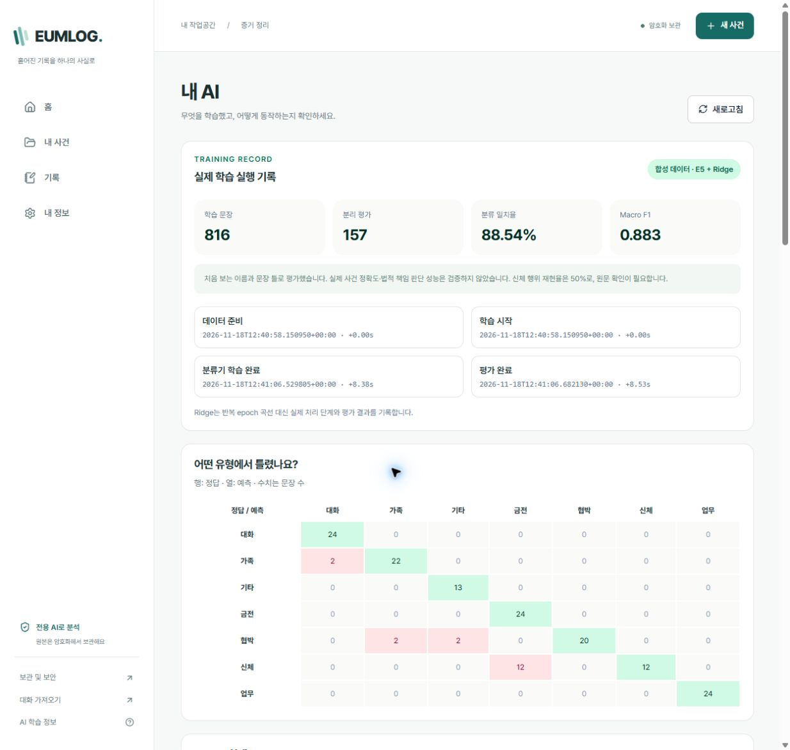
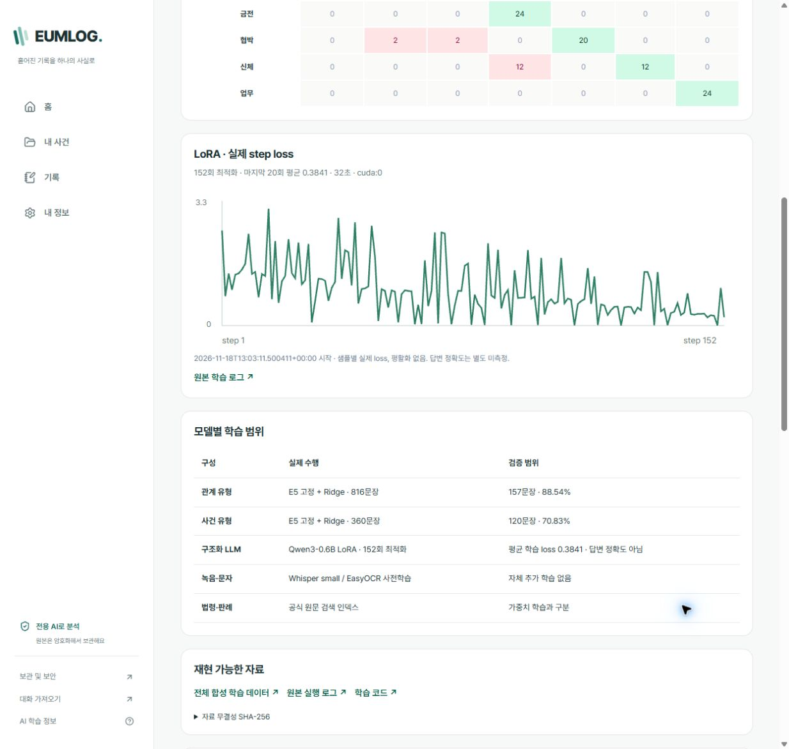
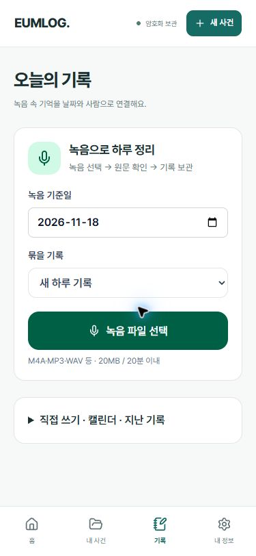
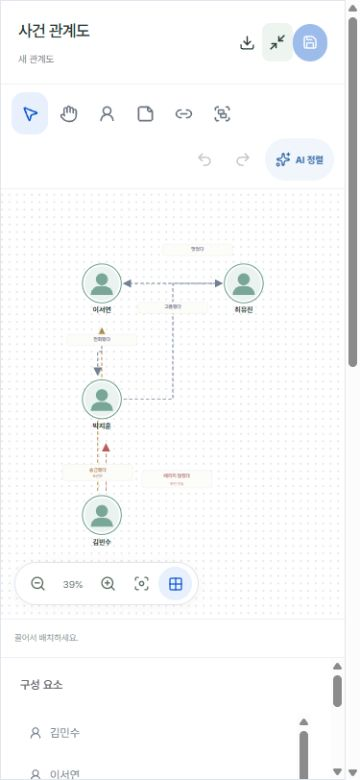
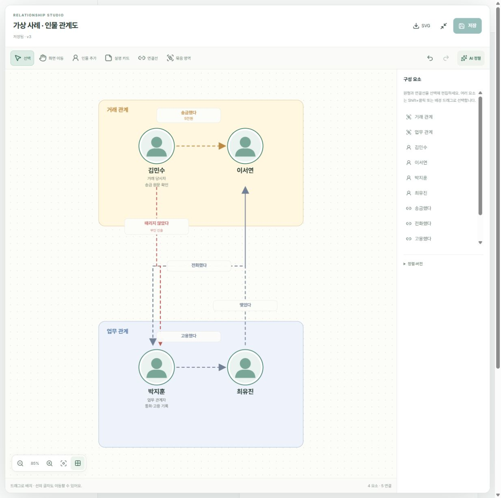

# EUMLOG · 이음로그

**녹음과 흩어진 자료를, 근거가 연결된 사건 기록으로.**

[앱 열기](https://eumlog-evidence.vercel.app) · [학습 데이터](ai/data/README.md) · [학습 실행 기록](ai/training/README.md) · [설치·운영](README-LOCAL.md)

FACTLINE을 기반으로 만든 모바일 우선 증거정리 앱입니다. 녹음·대화·사진·문서를 실제로 읽고 인물과 행위의 연결을 원문과 함께 보여줍니다. AI 제안과 사용자가 확인한 기록을 구분합니다. 상담·법률 검토에 필요한 자료를 준비하는 제품이며 유무죄·승소 확률을 판정하지 않습니다.

## 제품 흐름

~~~mermaid
flowchart LR
 A["녹음 / 대화 / 사진 / 문서"] --> B["암호화 원본 + SHA-256"]
 B --> C["전사·OCR·텍스트 추출"]
 C --> D["인물 / 행위 / 날짜 / 금액"]
 D --> E["실시간 관계도 + 원문 위치"]
 E --> F["사용자 확인"]
 F --> G["하루 기록 / 타임라인"]
 G --> H["법령·판례·누락 자료 검토"]
 H --> I["상담 준비 보고서 / JSON / PDF 인쇄"]
~~~

1. **오늘의 기록**에서 녹음 기준일과 M4A·MP3·WAV 등 파일을 선택합니다.
2. 로컬 Whisper가 변환한 구간을 누르면 원본의 해당 위치를 재생합니다.
3. 문장을 골라 하루 기록으로 보관합니다. 원본 증거와 연결되며 같은 원본의 중복 저장을 막습니다.
4. **증거** 화면의 인물·행위·금액 관계도가 처리 단계에 따라 갱신됩니다. 별도 웹 화면도 보이는 동안 약 2초 간격으로 동기화합니다.
5. 연결을 눌러 원문을 확인한 뒤 타임라인에 반영합니다. 전체 검토에서는 공식 원문, 확인 질문, 내 과거 기록을 함께 봅니다.

## 실제 화면

화면의 인물과 사건은 소프트웨어 설명용 합성이며 실제 사건·상담 기록이 아닙니다.

| 모바일 녹음 기록 | 근거가 연결된 인물 관계도 |
|---|---|
|  |  |

Pretendard를 자체 호스팅하고 기존 민트·아이보리 인상을 유지합니다. 모바일은 날짜·파일 선택을 먼저 배치하고 메모·언어 분석·해시는 펼쳐 봅니다. 관계도는 세로 배치·중심 인물 선택·연결 목록을 지원합니다.

## 관계도 편집 스튜디오

사진 예시처럼 **인물 원형·사진·설명 카드·묶음 배경·행위 화살표**를 각각 편집합니다. 전체 화면으로 넓게 편집하거나 모바일에서 이동·확대해 사용할 수 있습니다.

- 선택·다중 선택·드래그 이동, 격자 스냅·정렬 안내선, 묶음 이동·크기 조절.
- 직접 인물·카드·연결선 추가, 표시 이름·설명·색·점선·직선/꺾은선 편집.
- 선의 꺾이는 위치와 라벨을 각각 이동. 같은 사건에 보관한 사진을 인물 원형에 사용.
- 실행 취소/다시 실행, 확대·화면 이동·전체 맞춤, 키보드 단축키, 터치·두 손가락 확대 처리.
- 편집 가능한 SVG 저장. 원본 사진은 인증 후 SVG 안에 포함하며 외부 공개 URL을 만들지 않음.
- 저장 위치·표시는 암호화된 별도 관계도 문서. 버전 충돌 시 덮어쓰지 않고 현재 편집을 보존.

**AI 정렬**은 브라우저에 내장한 작은 배치 랭커가 6개 후보의 겹침·선 교차·라벨 충돌·간격을 비교합니다. E5 관계 추출 모델과 역할이 다릅니다. 새 증거가 들어와도 사용자가 저장한 배치는 유지됩니다. 직접 작성한 선과 부인·전언·예정 진술은 표시를 유지하며, 편집으로 원본 사실·증거 해시·확인 상태를 바꾸지 않습니다.

[배치 학습 코드](ai/train_layout.py) · [실제 실행 지표](ai/training/layout-run.json) · [내장 가중치](src/domain/services/layout-ranker.json)

학습은 자체 합성 그래프 480개/2,880개 배치, 분리 평가는 120개/720개 배치입니다. 8개 기하 특징으로 Ridge를 학습했습니다. 기하 목표의 최상위 선택과 일치율 61.67%이며 **사람의 미적 선호나 실제 사건 정확도가 아닙니다**. 배치·정리·편집에는 외부 추론 API나 PC GPU 연결이 필요하지 않습니다. 새 증거의 언어·음성 분석은 기존 PC 분석기를 사용합니다.

[실제 벡터 SVG 예시](docs/screenshots/diagram-example.svg)

## 실제 AI와 학습 범위

외부 LLM·음성 인식 추론 API를 호출하지 않습니다. 설치 때 공개 모델 파일을 내려받고 연결된 Python 분석기에서 실행합니다. Google 로그인과 Vercel 저장소·웹 호스팅은 네트워크 서비스입니다.

| 구성 | 구현 | 자체 학습 / 검증 |
|---|---|---|
| 한국어 분석 | Kiwi 형태소·품사·문장 분리 | 사전학습 모델 사용 |
| 의미 표현 | multilingual-e5-small, 384차원 | 인코더 고정, 기본 모델 재학습 없음 |
| 사건 유형 | E5 + Ridge 6종 | 합성 360개 학습 / 표현군 분리 120개 평가, **70.83%** |
| 관계 유형 | E5 + Ridge 7종 | 합성 816개 학습 / 새로운 이름·문형 157개 평가, **88.54%**, Macro F1 **0.883** |
| 인물·방향·부인 | Kiwi 조사·품사와 원문 구간 검증 | 문법 규칙 + 학습 유형, 완전 학습형 NER 아님 |
| 구조화 LLM | Qwen3-0.6B + LoRA r8, q/v projection | 합성 구조화·질문 120개 + 공식 원문 맥락 32개, 152회 최적화 |
| 자유 질의응답 | Qwen3 기본 모델 + 내 자료·법령 RAG | 구조화 전용 어댑터는 자유 응답 때 비활성화 |
| 녹음 | Whisper small + PyAV | 사전학습 사용, M4A·WAV·WebM 실제 디코딩 검사 |
| 사진·스캔 | EasyOCR 한국어·영어 | 사전학습 사용, PDF·이미지 검사 |
| 원문 검색 | E5 의미 60% + Kiwi TF-IDF 40% | 법령 5종·판례 4건, **2,105개 검색 구간** |
| 자료 비교 | 의미·형태소 유사도와 PMI | 유사도·공동 출현은 인과관계가 아님 |

**평가는 소규모 합성 데이터의 내부 측정입니다.** 관계 유형의 신체 행위 재현율은 50%, 금전 유형 정밀도는 약 66.7%입니다. 이 수치를 실제 사건 판단 정확도나 사용자 효용으로 광고하지 않습니다. LLM loss는 답변 정확도가 아닙니다. 실제 사건·상담 및 법률 판단 성능은 별도 검증이 필요합니다.

[관계 실행 로그](ai/training/latest-run.json), [LoRA 실행 로그](ai/training/lora-run.json), [모델 지표](ai/training/baseline-metrics.json)에 실제 수치·설정·해시가 있습니다. 학습 화면은 해당 기록을 읽습니다. 가짜 epoch·학습 곡선을 만들지 않습니다.

## 데이터와 출처

| 자료 | 파일 | 사용 |
|---|---|---|
| 자체 합성 상담 480문장 | [supervision.json](ai/data/supervision.json) | 사건 유형 분류, 구조화 예시 |
| 자체 합성 관계 973문장 | [relation-supervision.json](ai/data/relation-supervision.json) | 관계 학습·분리 평가 |
| 이번 LoRA의 정확한 152쌍 | [lora-samples.json](ai/training/lora-samples.json) | 실제 입력·정답 |
| 공식 법령·판결 원문 | [sources.json](ai/data/sources.json) | URL·수집일·SHA-256·본문 길이·권리 근거 |
| 실제 음성 검사 | [audio-check.json](ai/training/audio-check.json) | 합성 한국어 녹음의 실제 전사·구간 |

법령은 학교폭력예방법·시행령, 형법, 민법, 개인정보보호법입니다. 판례는 학교폭력 행정·집행정지, [사기 2011도8829](https://www.law.go.kr/precInfoP.do?precSeq=158543), [손해배상 2025다211430](https://www.law.go.kr/precInfoP.do?precSeq=614371) 등 선별 **4건**입니다. 전국 판례 전체 검색을 대체하지 않습니다. 조문별 구간은 원문 링크·해시를 유지합니다. 사건 당시 시행 법령·부칙은 별도로 확인하세요.

실제 상담 개인정보·사용자 증거는 학습에 넣지 않으며 자동 재학습하지 않습니다. 첨부 뉴스 관계도는 시각적 참고이며 학습·데모 사실 데이터로 쓰지 않았습니다. 권리·출처가 불명확한 상담·상용 판례 데이터는 포함하지 않았습니다. [모델 라이선스](ai/MODEL-NOTICES.md)를 확인하세요.

## 시스템과 데이터 흐름

~~~mermaid
flowchart TB
 subgraph Client["모바일 / 데스크톱"]
  UI["Next.js / React / Pretendard"]
  MAP["SVG 관계도 / 원문 재생 / 연결 목록"]
  UI --> MAP
 end
 subgraph Web["Vercel"]
  AUTH["세션 / 계정별 권한 / Google 토큰 검증"]
  API["증거·기록·검토 API"]
  JOB["암호화 작업 상태 / lease / 재시도"]
  VAULT["비공개 Blob · AES-256-GCM"]
  AUTH --> API --> JOB
  API --> VAULT
 end
 subgraph Worker["연결 PC · Python / CUDA"]
  BRIDGE["인증된 제한 작업 브리지"]
  MEDIA["PyAV / Whisper / EasyOCR"]
  NLP["Kiwi / E5 / Ridge / Qwen LoRA"]
  INDEX["공식 법령·판결 인덱스"]
  BRIDGE --> MEDIA --> NLP --> INDEX
 end
 UI --> AUTH
 JOB --> BRIDGE
 NLP --> JOB
 UI -->|"보이는 동안 polling · ETag"| API
~~~

웹은 Vercel, 모델은 연결된 PC의 RTX 3080 10GB에서 실행합니다. 인증 토큰과 허용 작업 목록을 가진 브리지로만 접근합니다. PC를 끄면 원본은 보관되고 분석은 대기합니다. 자동 재시작·연결 갱신을 제공하지만 현재 PC·임시 터널에는 24시간 운영 보장이 없습니다.

~~~mermaid
erDiagram
 USER ||--o{ CASE : owns
 USER ||--o{ LIFE_RECORD : owns
 CASE ||--o{ EVIDENCE : contains
 CASE ||--o{ EVENT : confirms
 EVIDENCE ||--o{ ANALYSIS : produces
 ANALYSIS ||--o{ RELATION : proposes
 EVIDENCE ||--o| LIFE_RECORD : source
 EVENT }o--o{ EVIDENCE : cites
~~~

관계는 원문 인용·원본 ID·후보 ID·UTF-16 구간·방향·부인/불확실/예정 상태·녹음 위치를 유지합니다. 자동 관계를 확정 사실로 저장하지 않습니다. 같은 사건의 명시된 이름은 묶고 대명사·별칭은 원본별로 나누지만, 같은 이름의 동일 실인물 여부를 검증하지는 못합니다.

법률 검토는 금전·신체·위협 관련 **원문 언급 / 추가 확인 질문**입니다. 단순 송금을 사기로 확정하지 않고 당시 설명·지급과의 연결·당시 의사와 능력을 구분합니다. 이 목록은 규칙 기반이며 법률 요건 충족 판정 모델이 아닙니다. 과거 기록은 내 계정의 잠기지 않은 최근 30개 정리의 설명·확인 진술만 의미 비교합니다.

## Google 로그인 · ID는 나중에

연결 코드는 준비되었습니다. **현재 배포에는 Client ID가 없으므로 Google 로그인은 비활성**이며 기존 이메일 로그인을 유지합니다.

1. Google 웹 OAuth 클라이언트의 승인된 JavaScript 출처에 https://eumlog-evidence.vercel.app 과 http://localhost:3000 을 등록합니다.
2. Vercel eumlog-evidence의 Production 변수 **GOOGLE_CLIENT_ID**를 추가하고 재배포합니다. GIS ID-token 방식으로 Client Secret은 사용하지 않습니다.
3. 공식 Google 버튼의 실제 로그인을 확인합니다. 기존 이메일 계정은 마이페이지에서 **현재 비밀번호 재확인 후 명시적으로 연결**합니다.
4. 연결을 확인한 뒤 원할 때 **PASSWORD_LOGIN_ENABLED=false**로 전환합니다.

Google 서명·issuer·audience·만료·검증 이메일·nonce·안정적인 sub를 확인합니다. ID가 없는 현재 상태에서는 실제 Google 계정 E2E를 수행하지 않았습니다. 검증 로직은 로컬 서명 토큰으로 검사했습니다. [Google 공식 문서](https://developers.google.com/identity/gsi/web/guides/verify-google-id-token)를 기준으로 구현했습니다.

## 실행과 검증

상세 명령은 [설치·운영](README-LOCAL.md)을 참고하세요. 설정된 PC에서는 Start-EUMLOG.cmd로 로컬 앱을, Start-EUMLOG-Cloud.cmd로 공개 웹의 분석기를 실행합니다.

~~~powershell
npm ci
node scripts/init-local.mjs
# Python·PyTorch·공개 기본 모델 설치: README-LOCAL.md
npm run ai:relations
npm run ai:check-relations
npm run ai:check-audio
npm test
npm run build
npm run start
~~~

작은 자체 분류기·LoRA 어댑터·검색 인덱스는 Git에 포함합니다. 대형 기본 모델 캐시·원본 증거·비밀키·가상환경은 제외합니다. Pickle은 신뢰하는 이 저장소 또는 직접 학습한 파일만 로드하세요. [검증 기록](docs/verification.md)에 확인 범위와 제외 사항을 남깁니다.

## 사업화 가설

가치는 **상담을 시작하기까지 드는 자료 정리 시간 감소**입니다. 개인·보호자가 평소 음성을 하루 기록으로 보관하고 필요할 때 근거 묶음을 만드는 흐름을 우선합니다. 상담기관·학교 지원기관·법률사무소 협력은 검증할 가설이며 실제 제휴·매출·고객 수를 확보했다고 주장하지 않습니다.

| 가설 | 측정 지표 | 유료화 후보 |
|---|---|---|
| 음성 입력이 기록 부담을 줄인다 | 첫 기록 완료율·시간·전사 수정량 | 보관 용량·월 녹음 처리량 |
| 근거 연결이 상담 준비를 줄인다 | 원문 확인율·정리 시간·재작업 | 사건별 정리·내보내기 |
| 기관의 자료 접수에 쓸 수 있다 | 동의 기반 접수율·누락 감소 | 기관 워크스페이스·권한 관리 |

결제·기관 공유·전문가 연결은 아직 구현하지 않았습니다. GPU·저장·전사 비용을 실측한 뒤 가격을 검증해야 합니다. 암호화 JSON 상태는 소규모 배포용으로 상용 운영에는 DB·큐·감사·보관 정책 검증이 필요합니다. 원본 진위·취득 적법성·법적 증거능력을 보장하지 않습니다.
