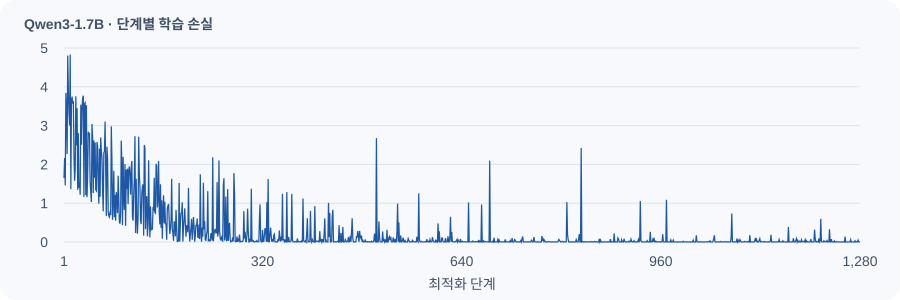

# 학습 실행 자료

[학습 화면](https://eumlog-evidence.vercel.app/models) · [데이터 카드](../data/README.md) · [사용조건](../MODEL-NOTICES.md)

## 한국어 기록 정리

Qwen3-1.7B의 q/v projection에 LoRA r8, alpha 16, dropout 0.05를 적용했습니다. seed 91, AdamW 6e-5, 개별 샘플 640쌍 × 2회로 1,280번 최적화했습니다. 저장한 로그상 소요 시간은 398.35초, 마지막 20회 평균 손실은 0.00923입니다. 구성은 합성 사례 240, 한국어 역할·부인·전언·예정 문형 변형 160, 공식 법률 원문 맥락 120, KLUE 관계를 문답으로 바꾼 자료 120쌍입니다. [정확한 입력·정답](dialogue-samples.json) · [학습 코드](../train_dialogue.py) · [실행 로그·해시](dialogue-run.json)



소량의 비슷한 답변을 반복해 손실이 빠르게 낮아졌습니다. 어댑터를 강하게 적용했을 때 한국어 표현이 부자연스러워 소수 문장으로 배율 0, 0.15, 0.35를 비교하고 현재 설정 0.15를 선택했습니다. 추가 여섯 질문을 그대로 공개합니다. 예를 들어 전언의 뜻을 설명했지만 지정 키워드 ‘전언’을 쓰지 않은 응답, 최종 결론을 유보하면서 근거 없는 법률 설명을 생성한 응답이 있습니다. 서비스는 법률 관련 키워드가 있는 질문에 검색된 원문과 사전 정의한 확인 질문을 제시합니다. 이 평가로 독립적인 사실 정확도나 한국어 일반 능력을 추정할 수 없습니다. [배율 비교](dialogue-calibration.json) · [응답 원문](dialogue-evaluation.json)

## 관계 분류와 배치

| 실행 | 데이터·측정 | 원본 |
|---|---|---|
| 사건 분류 · E5 고정 + Ridge | 합성 360 학습 / 120 평가, 6종 일치율 70.83% | [기존 실행 지표](baseline-metrics.json) |
| 서비스 관계 분류 · E5 고정 + Ridge | 합성 816 학습 / 157 평가, 7종 일치율 88.54%, Macro F1 0.883. 신체 유형 재현율 50%, 금전 유형 정밀도 66.7% | [단계·혼동행렬·해시](latest-run.json) |
| 공개 KLUE RE 연구 · 고정 E5 + Ridge | 8,493 학습 / 7,633 평가, 정확도 9.92%, Macro F1 0.103 | [실행·출처](korean-relations-run.json) |
| 공개 KLUE RE 연구 · E5 LoRA + 선형층 | 12,000 학습, 2회 반복·1,500단계. 같은 검증 7,633개에서 정확도 57.15%, Macro F1 0.197 | [종류별 결과·손실·해시](korean-pairs-run.json) |
| 구조화용 Qwen3-0.6B LoRA | 합성 문답 120쌍과 공식 원문 맥락 32쌍으로 152단계. 기존 구조화 작업용 | [학습쌍](lora-samples.json) · [원본 로그](lora-run.json) |
| 기기 내 배치 Ridge | 합성 그래프 480 학습 / 120 평가, 그래프당 후보 6개. 기하 목표의 최상위 후보 일치 61.67% | [설정·해시](layout-run.json) · [Python·브라우저 특징 대조](layout-parity.json) |
| 기기 내 좌표 생성 MLP | 같은 그래프 분할의 4,132개 학습 노드·962개 평가 노드. ReLU 8→24→16→2로 212회 학습. 합성 스프링 교사와의 정규화 좌표 MAE 0.02223 (초기 0.23027) | [학습 코드](../train_layout_generator.py) · [실제 지표·해시](layout-generator-run.json) · [브라우저 가중치](../../src/domain/services/layout-generator.json) |

KLUE 평가는 이미 주어진 개체 쌍의 관계 30종을 분류합니다. 학습 원문과 동일한 검증 문장을 제외했으며 문서 단위 독립성을 검증하지는 않았습니다. 가장 흔한 `no_relation`만 선택하는 기준은 4,573/7,633(59.91%)입니다. 위 두 KLUE 모델은 연구용으로 남기고 앱의 자동 관계 제안은 기존 7종 분류기와 원문 대조 규칙을 씁니다. 서로 다른 분류 과제의 정확도를 직접 비교할 수 없습니다.

## 재현

설치된 분석 PC의 저장소 루트에서 실행합니다. 이 명령은 데이터·가중치·실행 기록을 다시 생성하므로 기존 결과와 비교하려면 먼저 별도 작업 사본을 사용하세요. 사전학습 모델 판본, Python·CUDA 환경, 수집 시점이 달라지면 결과와 해시도 바뀔 수 있습니다. [설치](../../README-LOCAL.md)

```powershell
node scripts/python.mjs download_dialogue.py
node scripts/python.mjs expand_korean.py
node scripts/python.mjs train_korean_pairs.py
node scripts/python.mjs train_dialogue.py
node scripts/python.mjs calibrate_dialogue.py
node scripts/python.mjs check_dialogue.py
node scripts/python.mjs train_layout_generator.py
.venv\Scripts\python.exe docs/plot_dialogue.py
npm run ai:check-training
```

기존 코퍼스 스냅샷을 그대로 사용할 때는 재수집할 필요가 없습니다. 선택한 법령·판례 스냅샷을 갱신할 때는 `node scripts/python.mjs expand_legal.py` 후 `npm run ai:index`를 실행합니다. 관계·배치 분류기 재학습 명령은 각각 `npm run ai:relations`, `npm run ai:layout`입니다. 시연 JSON은 `node scripts/python.mjs generate_demo.py`로 원문 4개를 실제 추론하여 다시 만들 수 있습니다. [실행 요약](demo-run.json)

기존 파이썬 음성 변환 검사 결과는 [audio-check.json](audio-check.json), 기기 브라우저용 음성 모델 판본과 파일 크기는 [browser-speech-models.json](browser-speech-models.json)에 있습니다.
